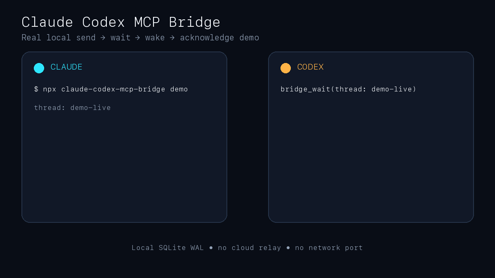

<p align="center">
  <a href="https://www.webisitystudio.co.uk/">
    
  </a>
</p>

<h1 align="center">Claude Codex MCP Bridge</h1>

<p align="center">Built by <a href="https://www.webisitystudio.co.uk/">WebiSity Studio</a></p>

[](https://github.com/WebisityStudio/claude-codex-mcp-bridge/actions/workflows/ci.yml)
[](LICENSE)

<p align="center">
  
</p>

A local MCP bridge for Claude Code and OpenAI Codex. It gives a team of Claude and Codex conversations a durable SQLite mailbox, background pings between them, and saved Codex workers that run in a pinned sandbox and report back on their own.

```text
Claude Code ──stdio MCP──┐
                         ├── local SQLite WAL store (private to your user)
Codex       ──stdio MCP──┘
```

The default mode has no account, cloud relay, HTTP server or listening network port.

## Why

Plain MCP tools are request-response. Writing a message to a mailbox does not automatically start a new model turn in another chat. The bridge supports three patterns:

1. **Background pings (experimental, macOS):** bind each conversation once with `wake: "auto"`; a durable message pings an idle recipient through its app's local interface. If a ping cannot be delivered, the sender is told automatically. See [background setup and limits](docs/BACKGROUND-WAKE.md).
2. **Active waits:** agents without pings use `bridge_wait` before going idle. The pending call returns when a matching message arrives.
3. **Codex workers:** Claude calls `ask_codex`, `review_with_codex` or `bridge_orchestrate_codex`. The bridge starts a saved Codex session in an isolated worktree. If Codex needs longer than one tool call, the result arrives in the coordinator's mailbox when it finishes.

See [INSTRUCTIONS.md](INSTRUCTIONS.md) for copy-paste prompts.

## Features

- Local SQLite WAL mailbox with versioned, backed-up migrations and daily backups
- Direct messages, broadcasts, stable thread IDs and idempotency keys
- Recipient-scoped acknowledgements, an outbox of what others have not handled, and agent retirement that closes finished work with a recorded reason
- Recipient checks: unknown names are rejected with "did you mean" suggestions, and senders get warnings when a message is unlikely to be picked up
- Output paging so large inboxes, threads, agent lists and ping histories never overflow an MCP result
- Optional background pings with delivery receipts, a 24-hour window for busy recipients and automatic notices to the sender when a ping fails
- Worker chats in either app: Codex workers with the sandbox pinned on every turn, and Claude Code workers in a chosen permission mode, each with a chosen model and reasoning effort
- An owner-set ceiling for what agents may choose and how many worker chats they may start
- Codex worker chats that appear in the Codex app, and Claude worker chats that can be opened in the Claude desktop app
- Read-only reviews, bridge-observed file changes and background completion through the mailbox
- Worktrees outside your repository, with an option to carry uncommitted changes in
- Recovery of Codex runs whose bridge process exited mid-turn
- A versioned runtime with smoke-tested installs and one-command rollback

## Tools

| Tool | Purpose |
|---|---|
| `bridge_register` | Register an agent; `wake: "auto"` binds this conversation for background pings |
| `bridge_send` | Save a message, ping a bound recipient, and warn about delivery risks |
| `bridge_inbox` | Read unread messages in pages that fit the host's output limit |
| `bridge_ack` | Acknowledge handled messages without deleting history |
| `bridge_wait` | Keep the current turn open until a matching message arrives |
| `bridge_thread` | Read a thread, newest page first, with cursors both ways |
| `bridge_outbox` | See which of your messages recipients have not handled, and why |
| `bridge_agents` | List agents, most recently active first, with unread counts and ping health; paged and searchable |
| `bridge_retire` | Retire a finished agent and close its unhandled messages |
| `bridge_sessions` | Discover live Claude sessions and this conversation's own session |
| `bridge_wake_status` | Inspect ping outcomes separately from acknowledgements, newest first, in pages |
| `ask_codex` | Send one bounded task to a new Codex chat in an isolated worktree, with an optional model, reasoning effort and sandbox |
| `ask_claude` | Send one bounded task to a new Claude Code chat, with an optional model, reasoning effort and permission mode |
| `review_with_codex` | Run an evidence-led review in a read-only sandbox |
| `bridge_orchestrate_codex` | Start a Codex run with rounds, worktree and wait controls |
| `bridge_continue_run` | Resume the same worker chat (Codex or Claude) with the coordinator's answer |
| `bridge_continue_codex` | Earlier name of `bridge_continue_run`, kept for existing callers |
| `bridge_orchestration_wait` | Wait for a running worker run started by any bridge process |
| `bridge_orchestration_status` | Read durable run state and audit events |

## Requirements

- A stable Node.js release in one of these supported lines: 22.x >=22.23.4, 24.x >=24.22.1, or 26.x >=26.12.1
- Claude Code
- OpenAI Codex CLI
- Git, for worktree isolation

The mailbox works anywhere Node and both MCP clients run. The Codex launcher uses `CODEX_BIN` when set, then the Codex binary bundled in the macOS ChatGPT app, then `codex` from `PATH`. Claude workers and registration use `CLAUDE_BIN` when set, then the newest Claude Code bundled with the Claude desktop app, then `claude` from `PATH`; `ask_claude` also needs that CLI signed in once with `claude auth login`, because the desktop app's sign-in does not cover it.

These Node.js minimum versions include the [October 21, 2026 security fixes](https://nodejs.org/en/blog/vulnerability/october-2026-security-releases). Setup and `doctor` reject older versions, prereleases and other major release lines. Later stable patches and minor releases within 22.x, 24.x and 26.x are accepted; a patched 26.12.1 installation can stay on that line.

Core tests run on macOS, Linux and Windows in GitHub Actions. Background pings and the live Claude Desktop plus Codex Desktop workflow were developed and verified on macOS.

## Install

### One command

```bash
npx --yes --package=github:WebisityStudio/claude-codex-mcp-bridge claude-codex-mcp-bridge setup
```

Setup:

- installs the package as a new runtime version under `~/.local/share/claude-codex-bridge/runtime/versions/`;
- starts that runtime against a throwaway mailbox and checks its tools before activating it;
- points Claude Code and Codex at `runtime/current`, so updates and rollbacks never touch a checkout you are editing;
- edits only the bridge's own entry in Codex's `config.toml` (per-tool approval settings are kept, and a backup is written) and sets `tool_timeout_sec = 300` so waits are not cut at Codex's 60-second default;
- installs the `ask-codex`, `review-with-codex` and coordinator skills plus a `codex-teammate` Claude agent.

Setup keeps the Node.js binary your apps already launch the bridge with when it meets the supported security baseline (pass `--node PATH` to choose another). If a registered runtime is too old, setup tries the other registration and then the Node.js running setup; it stops if none meets the baseline. It registers through the newest Claude Code bundled with the desktop app when present (`CLAUDE_BIN` overrides), so an older standalone `claude` on `PATH` never rewrites your Claude settings. Later updates switch the `current` link; MCP configuration changes only when registration needs repair or a different Node.js binary is selected.

Open fresh Claude and Codex sessions afterwards. Running sessions keep the bridge they started with.

```bash
npx --yes --package=github:WebisityStudio/claude-codex-mcp-bridge claude-codex-mcp-bridge doctor
```

### From a checkout

```bash
git clone https://github.com/WebisityStudio/claude-codex-mcp-bridge.git
cd claude-codex-mcp-bridge
npm ci
npm run check
node dist/cli.js setup
```

`setup` refuses to install a `dist/` that is older than `src/`. Run `npm run build` first.

## Everyday use

In the **Claude desktop app → Code tab**, ask: “Start a separate local Claude session called
Schema Review now. Have it review the migration without editing anything, then report back
here.” The included `/desktop-coordinator` skill uses the app's native start and messaging
tools. The worker has its own sidebar conversation; follow-ups go to that same session.
If the app asks for approval or only offers a suggestion, the session has not started yet.
This workflow requires the desktop session tools to be available in the lead conversation.

After opening a fresh Claude session:

```text
/ask-codex investigate why the authentication tests are flaky
/review-with-codex focus on authentication and tenant isolation
```

Or ask Claude directly:

```text
Ask Codex to implement this change and verify it.
Have Codex review this repository for security regressions.
```

The project path defaults to the Claude session's project. A call waits up to four minutes. If Codex is still working, the call returns `running_codex` and the result arrives later in your mailbox from `bridge`, which also pings your conversation if it is bound. Do not start a duplicate run.

## Background pings

Bind each conversation once:

```json
{"agent": "review-claude", "wake": "auto"}
```

Claude sessions are detected automatically. For Codex, pass `{"app": "codex", "sessionId": "<task ID>"}` when `auto` cannot see the task ID. Then send normally, acknowledge after handling, and end the turn when no work remains. See [the background wake guide](docs/BACKGROUND-WAKE.md) for receipt states and limits.

When a ping cannot be delivered, the sender receives one automated notice from `bridge` explaining why and what to do. The most common cause is Claude Code holding messages for sessions that run in Bypass permissions (its `crossSessionInbound` setting). The bridge explains this but never changes that setting.

## Fallback: active waits

Pick one canonical thread ID, register unique names, send with `bridge_send`, and wait with:

```json
{
  "agent": "claude-main",
  "fromAgent": "codex-main",
  "threadId": "invoice-review-001",
  "timeoutSeconds": 285,
  "acknowledge": true
}
```

Most MCP hosts cut tool calls near five minutes, so waits are capped at 290 seconds. Renew a timed-out wait while the task is active. A filtered wait only wakes for the exact sender and thread.

## Codex workers in detail

```json
{
  "projectPath": "/absolute/path/to/repository",
  "task": "Implement and test the bounded change",
  "threadId": "feature-x",
  "useWorktree": true,
  "includeUncommitted": false,
  "maxRounds": 6,
  "waitSeconds": 240
}
```

- Implementation runs pin the `workspace-write` shell sandbox with network access off. Reviews pin `read-only`, including resumed turns. These shell settings do not revoke inherited MCP tools or their credentials: review the worker's effective Codex configuration before using untrusted inputs. Native CLI enforcement and separately configured tool permissions remain part of the boundary.
- Worktrees live under `~/.local/share/claude-codex-bridge/worktrees/` (or `BRIDGE_WORKTREE_ROOT`). They stay out of your repository, so Metro, `tsc`, Jest and `git status` never see them.
- Worktrees start from `HEAD`. When the main checkout has uncommitted changes, the result warns you; pass `includeUncommitted: true` to copy them in.
- Every result includes `observedChanges`, the bridge's own `git status` of the workspace, next to what Codex reports.
- If the status is `waiting_for_fable`, answer the question and call `bridge_continue_run` with the same run ID.
- Codex turns run as detached processes. If the bridge process that started one exits, another bridge process adopts the run, finishes it from its files and delivers the result.
- `BRIDGE_CODEX_CONFIG` can tune bridge workers without touching your interactive defaults, for example `model_reasoning_effort="medium"`. Sandbox and approval keys are ignored.

The bridge does not commit, push, merge, deploy or clean worktrees.

## Worker chats, visibility and the ceiling

An agent in one app can start a new chat in the other, or in its own, and choose how it runs:

| | `ask_codex`, `review_with_codex`, `bridge_orchestrate_codex` | `ask_claude` |
|---|---|---|
| Model | `model` | `model` (a name or an alias such as `haiku`) |
| Reasoning | `reasoningEffort` | `effort` |
| Access | `sandbox`: `read-only` or `workspace-write`, network off | `permissionMode`: `plan` or `manual` (read only), `acceptEdits` (edit files in a worktree), `auto` |
| Where you see it | In the Codex app's chat list; the result's `appLink` (`codex://threads/<id>`) opens it | In the Claude desktop app when `showInDesktop` is set |

- **Codex chats run through `codex app-server`**, the protocol the Codex apps use, so the app lists them. The turn still runs in a detached background process, not live in the app, and the app does not treat the chat as its own until you open it. Set `BRIDGE_CODEX_RUNNER=exec` to return to `codex exec`, whose sessions the app does not list.
- **Claude chats run through headless Claude Code** without MCP servers. When `showInDesktop` is set and the chat has finished, the bridge runs `claude --desktop --resume <session>` in a pseudo-terminal (macOS), and the desktop app switches to the chat. Elsewhere, or if that step fails, the result carries the command to run by hand.
- **Full access is never offered.** Workers cannot be given Codex's `danger-full-access` sandbox or Claude's bypass-permissions mode through the bridge.
- **The bridge does not use the Codex app's wake link** to make the app run a queued message. In testing the app ran such a chat with its own default model and permissions, not the ones requested.

### The ceiling

The bridge cannot see how much the agent that calls it is allowed to do, so the owner sets a ceiling and agents choose inside it. Without a file the defaults below apply. To change them, save this as `policy.json` in the bridge's data directory (`claude-codex-mcp-bridge policy` prints the effective policy and the path):

```json
{
  "maxStartsPerHour": 12,
  "allowedRoots": [],
  "codex": { "allowedModels": [], "maxEffort": "high", "maxSandbox": "workspace-write" },
  "claude": { "allowedModels": [], "maxEffort": "high", "maxPermissionMode": "acceptEdits", "showInDesktop": "on-request" }
}
```

- `maxStartsPerHour` counts Codex and Claude worker chats together, across every session sharing the mailbox.
- `allowedRoots` limits the folders a worker may be started in; an empty list means any folder.
- `allowedModels` limits the models an agent may name; an empty list means any model.
- `showInDesktop` is `never`, `on-request` (only when the tool call asks) or `always`.

A request above the ceiling is refused with the limit named; nothing is lowered silently. No tool can change the policy, and a policy file that cannot be read is an error rather than a fall-back to the defaults. Any local process that can edit files can still edit this one, so it is a guard against agents asking for too much, not a security boundary.

## Input and repository preparation limits

Tool calls allow at most 10,000 aggregate object keys/array elements. Agent names are limited to 128 characters, capabilities to 64 entries of 128 characters each, acknowledgements to 1,000 IDs per call, thread IDs to 512 characters, message bodies to 1,000,000 characters, and worker task/answer text to 200,000 characters. Split larger work across calls; existing mailbox history is retained.

Before launching a worker, bridge Git commands disable hooks, fsmonitor, external diff/textconv and configured clean/smudge/process filters. Repositories using Git LFS or custom checkout filters may therefore contain pointer or canonical bytes in a worktree; prepare trusted materialized files separately. Optional uncommitted copying rejects untracked symlinks and special files rather than reading through them. These checks assume repository directories and Git configuration are not being concurrently replaced by a hostile local writer; they are not a replacement for OS isolation of an untrusted local repository. Windows ACL and no-follow behavior require separate platform verification.

## Maintenance

```bash
claude-codex-mcp-bridge doctor          # installation, mailbox health, ping delivery, permissions
claude-codex-mcp-bridge doctor --fix    # also tighten mailbox file permissions
claude-codex-mcp-bridge status          # size, backlog, runs, latest backup
claude-codex-mcp-bridge prune           # list agents idle for 7+ days (dry run)
claude-codex-mcp-bridge prune --apply   # retire them and close their unhandled messages
claude-codex-mcp-bridge retire <agent> --note "task merged"
claude-codex-mcp-bridge backup          # manual point-in-time copy
claude-codex-mcp-bridge rollback        # switch back to the previous runtime
claude-codex-mcp-bridge uninstall       # keeps mailbox data unless --purge
```

Retiring never deletes messages. Closed messages keep their history and a note saying why, recently active senders get one notice listing what was closed, and registering the name again reactivates it.

## Storage

```text
~/.local/share/claude-codex-bridge/bridge.sqlite     mailbox (owner-only)
~/.local/share/claude-codex-bridge/backups/          pre-migration and daily backups (7 kept)
~/.local/share/claude-codex-bridge/runs/             Codex turn files (event streams pruned after 30 days; results kept)
~/.local/share/claude-codex-bridge/worktrees/        Codex worktrees (never cleaned automatically)
~/.local/share/claude-codex-bridge/runtime/          installed runtime versions
```

Override the mailbox in both MCP configurations with `BRIDGE_DB_PATH`. All MCP processes must point to the same database. Set `BRIDGE_BACKUPS=0` to disable daily backups.

Schema changes are additive and versioned. Before migrating an existing mailbox, the bridge writes a backup. Older bridge processes that are still running keep working against the migrated database.

## Honest limitations

- Background pings use observed local app interfaces, not public APIs. They need the app and its session host running.
- Claude Code holds pings for sessions in Bypass permissions, and the desktop app has no prompt to approve them, so they expire. Sessions in other permission modes, or a deliberate `crossSessionInbound: "accept"` setting, avoid this. The sender is notified either way.
- Claude Code channels (`BRIDGE_CLAUDE_CHANNEL=1`) are supported as an opt-in push path, but Claude Code only listens when launched with its channel flags, which the desktop app does not expose.
- Codex does not expose its task ID to MCP servers in every version, so `wake: "auto"` may need the ID passed explicitly.
- Registration proves discovery, not active processing. Acceptance of a ping is not completion of the work.
- The transport is local to one machine.

## Safety

- No credentials are stored by this project. The Claude wake adapter reads only the addressed inbox's published peer token into memory and never logs it. It never uses child tokens or claims a permission mode.
- The mailbox, backups and Codex turn files are owner-only. Messages are stored unencrypted, so do not send secrets through the mailbox.
- Child processes receive a small allowlist of environment variables, not the full parent environment.
- Worker sandboxes are pinned per turn. Worker prompts prohibit commits, pushes, deployments, external sends, credential changes, deletion and production mutations unless separately approved.
- Messages from `bridge` are automated notices. Agents are told not to reply to them, and notices never trigger further notices.

## Development

```bash
npm run typecheck   # src, tests and scripts
npm test
npm run build       # compiles into dist.next/ and swaps it in
npm run check       # all of the above
npm audit --omit=dev --audit-level=high
BRIDGE_CODEX_CONFIG='model_reasoning_effort="low"' npm run smoke:orchestrator   # live Codex run, fully isolated
```

The suite covers worker policy limits, Codex app-server and headless Claude turns against stand-in CLIs, the desktop hand-off, socket framing, identity and permission boundaries, migrations from 0.3 databases and compatibility with running 0.3 processes, ping persistence, crash recovery and failure notices, mailbox routing, addressing checks, retirement, paging, independent MCP processes, detached Codex turns with a fake Codex binary, orphaned run recovery, real git worktrees, Codex config edits and runtime rollback.

The tracked `npm-shrinkwrap.json` records dependency versions and integrity hashes in place of `package-lock.json`. `npm ci` reads it for checkout installs, and npm includes it in the package so setup's installed runtime uses the same locked production dependency versions. Refresh this lockfile deliberately when updating dependencies.

## Related work

This is not the only Claude/Codex bridge. See [docs/ALTERNATIVES.md](docs/ALTERNATIVES.md) for a comparison with Claude Channels bridges, ACP delegation tools and general agent mailboxes.

## License

MIT
